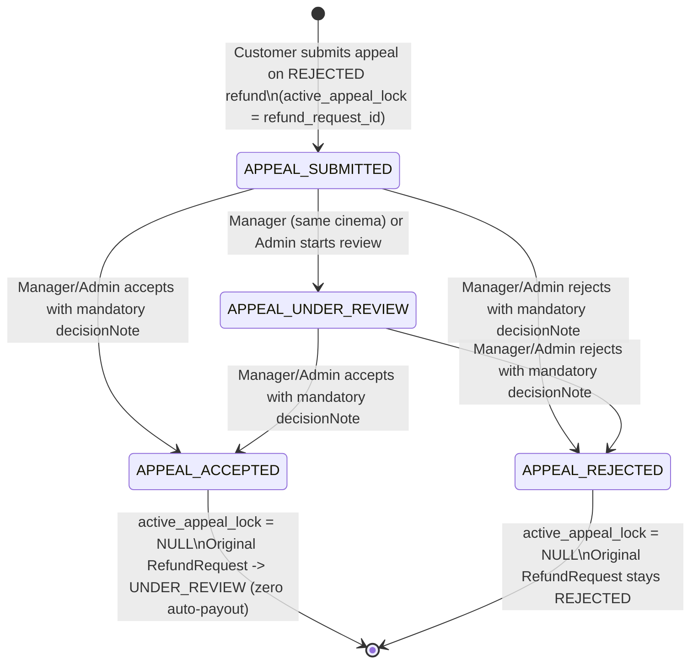
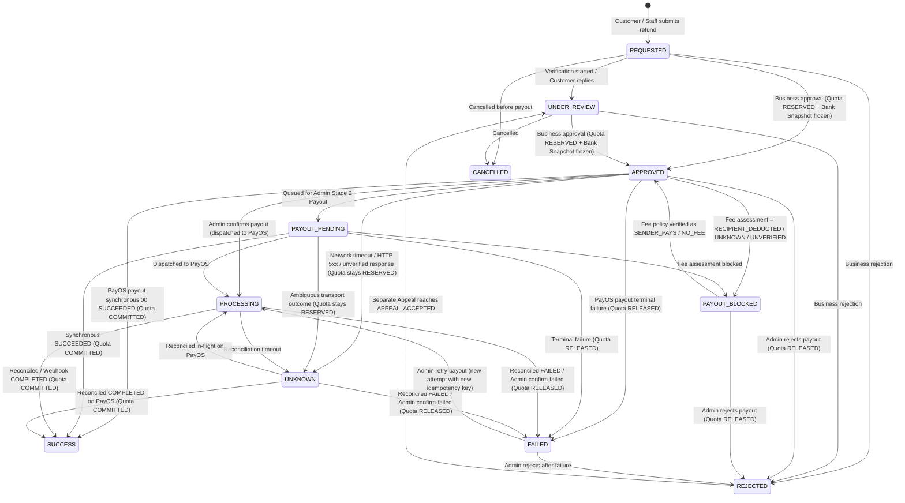

# BOX Cinema Refund & PayOS Payout — API, Payment & Authorization Specification

## 1. Complete API Catalog (Refunds, Incidents, Appeals, Evidence, Limits & Payouts)

All mutating endpoints enforce Spring Security session authentication (or verified purchase-email ownership for guest public lookup/submission), role-based access control (`@PreAuthorize`), CSRF token validation (`X-CSRF-TOKEN` on state-changing requests except signed webhook callbacks), and structured error responses (`GlobalExceptionHandler` with HTTP `Retry-After` on `429 Too Many Requests`).

### 1.1 Public & Customer Refund Endpoints (`PublicRefundApiController` — `/api/refunds/public`)

| HTTP Method & Path | Access / Auth | Rate Limit | Request Payload / Query Params | Response & Behavior |
|---|---|---|---|---|
| `GET /api/refunds/public/banks` | Public / Customer | Standard | None | Returns supported VietQR bank map (`BIN -> Bank Name`, e.g., `970422 -> MB Bank`, `970436 -> Vietcombank`). |
| `POST /api/refunds/public/lookup-order` | Public / Customer (Verified `orderCode` + `purchaseEmail`) | Standard | `{ "orderCode": "BOX-...", "purchaseEmail": "..." }` | `200 OK` (`OrderLookupResponseDto`): order metadata, `refundDeadlineAt`, `deadlineBasis` (`NORMAL_72H` / `LATE_INCIDENT`), `deadlineExceeded`, and per-item financial breakdown (`grossAmount`, `discountAllocated`, `netPaidAmount`, `remainingRefundableQuantity`, `checkedIn`/`USED` incident-reviewable status). Generic `400` on order/email mismatch to prevent enumeration. |
| `POST /api/refunds/public` | Public / Customer | `5 / customer / 10m` and `20 / IP / 1h` (`429` + `Retry-After`) | `PublicRefundSubmitRequestDto`: `orderCode`, `purchaseEmail`, `customerName`, `customerPhone`, `reasonCategory`, `description`, `evidenceUrl`, `savedBankAccountId` or `(toBin, toAccountNumber, confirmAccountNumber, accountHolderName, bankNote)`, `saveBankAccount`, `items[{itemKind, targetId, quantity}]` | `201 Created` (`RefundRequestDetailDto`): validates payload/bank/evidence first, enforces rate limits, checks `Asia/Ho_Chi_Minh` deadline, locks refundable items via `active_lock_key`, encrypts bank account (`AES-256-GCM`), links evidence files, and creates request in `REQUESTED` (`PENDING_REVIEW`). Missing cinema incident routes request for Manager investigation rather than auto-rejecting. |
| `GET /api/refunds/public/lookup` | Public / Customer (`refundCode` + `email`) | Standard | `?refundCode=RFD-...&email=...` | `200 OK` (`RefundRequestDetailDto`): returns masked bank account (`******1234`), separate `workflowStatus`, `payoutStatus`, `feeAssessmentStatus`, `payoutBlockedReason`, `refundMethod`, `bankAccountEditable` flag, item breakdown, approval history, and communications. |
| `POST /api/refunds/public/{refundCode}/respond` | Public / Customer (`purchaseEmail`) | Standard | `{ "purchaseEmail": "...", "message": "...", "evidenceUrl": "..." }` | `200 OK` (`RefundRequestDetailDto`): appends customer reply/additional evidence when in `MORE_INFO_REQUIRED` and returns request to `UNDER_REVIEW` (`UNDER_VERIFICATION`). |
| `PUT /api/refunds/public/{refundCode}/bank-account` | Public / Customer (Owner before business approval) | Standard | `RefundBankUpdateRequestDto`: `purchaseEmail`, `savedBankAccountId` or `(toBin, toAccountNumber, confirmAccountNumber, accountHolderName, bankNote)` | `200 OK` (`RefundRequestDetailDto`): updates encrypted bank account while `bankAccountEditable == true` (locked once business-approved). |
| `POST /api/refunds/public/{idOrCode}/appeals` (alias `/{idOrCode}/appeal`) | Public / Customer (Owner of `REJECTED` refund) | `5 / customer / 10m` and `15 / IP / 1h` (`429` + `Retry-After`) | `RefundAppealSubmitRequestDto`: `{ "purchaseEmail": "...", "appealReason": "...", "evidenceUrl": "..." }` | `201 Created` (`RefundAppealResponseDto`): creates a separate appeal in `APPEAL_SUBMITTED` with `active_appeal_lock = refund_request_id` (`409 APPEAL_ALREADY_OPEN` if one is already open; `409 APPEAL_ONLY_ALLOWED_WHEN_REJECTED` if refund is not `REJECTED`). |
| `GET /api/refunds/public/{idOrCode}/appeals` (alias `/{idOrCode}/appeal`) | Public / Customer (Owner) | Standard | `?email=...` | `200 OK` (`List<RefundAppealResponseDto>`): lists appeal records and `AppealHistoryItemDto` timeline for the customer's refund request. |
| `POST /api/refunds/public/evidence-upload` | Public / Customer | `15 / customer / 10m` and `30 / IP / 1h` | `multipart/form-data` (`file`) | `200 OK` (`{ "url": "/api/refunds/evidence/{storageName}" }`): validates extension, MIME, magic bytes, and deep content scan (`EvidenceMalwareScanner`). |
| `GET /api/refunds/public/evidence/{filename}` | **Authenticated Only** (`SecurityConfig`) | Standard | Path `@PathVariable filename` | `200 OK` (`Resource`): delegates to `EvidenceStorageService.authorizeAndLoadEvidence` (`401` if unauthenticated, `403` if unauthorized or `QUARANTINED`). |

### 1.2 Authenticated Evidence Upload & Download Endpoints (`RefundEvidenceApiController` — `/api/refunds/evidence`)

| HTTP Method & Path | Access / Auth | Rate Limit | Request Payload | Response & Security Headers |
|---|---|---|---|---|
| `POST /api/refunds/evidence/upload` | Authenticated (or Customer session) | `15 / customer / 10m` and `30 / IP / 1h` (`429` + `Retry-After`) | `multipart/form-data`: `files` (1–5 files, max 5 MB/file, 15 MB batch total) or `file`, optional `refundRequestId`, `incidentReportId` | `200 OK` (`{ "success": true, "url": "/api/refunds/evidence/{uuid}", "storageName": "{uuid}", "scanStatus": "CLEAN", "files": [...] }`). Rejects double extensions (`a.php.jpg`), path traversal, SVG/HTML/JS/PDF/EXE, MIME mismatches, invalid magic bytes, and polyglot/EICAR payloads (`400 EVIDENCE_QUARANTINED` persisted in `REQUIRES_NEW` tx). |
| `GET /api/refunds/evidence/{filename}` | **Authenticated** (`CUSTOMER` owner, `MANAGER`/`STAFF` assigned cinema, `ADMIN` all) | Standard | Path `@PathVariable filename` | `200 OK` binary image stream with `X-Content-Type-Options: nosniff`, `Cache-Control: private, no-store, max-age=0`, `Content-Security-Policy: default-src 'none'; img-src 'self'; style-src 'none'; sandbox`. Logs `EVIDENCE_DOWNLOADED` in `refund_audit_logs`. Returns `403 FORBIDDEN` for `QUARANTINED` files or cross-tenant/cross-customer access. |

### 1.3 Customer Saved Bank Account Endpoints (`CustomerBankAccountApiController` — `/api/customer/bank-accounts`)

| HTTP Method & Path | Access / Auth | Request Payload | Response & Behavior |
|---|---|---|---|
| `GET /api/customer/bank-accounts` | `CUSTOMER` (Authenticated) | None | `200 OK` (`List<CustomerBankAccountDto>`): returns only `accountNumberMasked` (`******1234`), `bankBin`, `bankName`, `accountHolderName`, `bankNote`, `isDefault` (never plaintext account numbers). |
| `POST /api/customer/bank-accounts` | `CUSTOMER` (Authenticated) | `CustomerBankAccountRequestDto`: `bankBin`, `accountNumber`, `confirmAccountNumber`, `accountHolderName`, `bankNote`, `isDefault` | `201 Created`: validates `accountNumber == confirmAccountNumber`, VietQR BIN format, encrypts account number via `BankDataEncryptionService` (`AES-256-GCM`), stores SHA-256 fingerprint and masked tail. |
| `PUT /api/customer/bank-accounts/{id}` | `CUSTOMER` (Owner only) | `CustomerBankAccountRequestDto` | `200 OK`: updates customer's own saved bank account (`403`/`404` on cross-customer ID). |
| `POST /api/customer/bank-accounts/{id}/default` | `CUSTOMER` (Owner only) | None | `200 OK`: marks the specified bank account as default for the customer. |
| `DELETE /api/customer/bank-accounts/{id}` | `CUSTOMER` (Owner only) | None | `204 No Content`: deletes the saved bank account (does not affect immutable snapshots already captured on approved refunds). |

### 1.4 Staff Counter & Incident Reporting Endpoints (`/api/staff/**`)

| HTTP Method & Path | Access / Auth | Request Payload | Response & Behavior |
|---|---|---|---|
| `GET /api/staff/refunds` | `STAFF`, `MANAGER`, `ADMIN` | Filter params (`status`, `payoutStatus`, `reasonCategory`, `search`, `page`, `size`) | `200 OK` (`Page<RefundRequestDetailDto>`): strictly isolated to the staff member's assigned `cinemaId`. |
| `GET /api/staff/refunds/{id}` | `STAFF`, `MANAGER`, `ADMIN` | `@PathVariable id` | `200 OK` (`RefundRequestDetailDto`): read-only inspection for assigned `cinemaId` (`403` cross-cinema). |
| `POST /api/staff/refunds/lookup-order` | `STAFF`, `MANAGER`, `ADMIN` | `{ "orderCode": "...", "purchaseEmail": "..." }` | `200 OK` (`OrderLookupResponseDto`): branch-scoped counter lookup (`403` cross-cinema). |
| `POST /api/staff/refunds` | `STAFF`, `MANAGER`, `ADMIN` | `PublicRefundSubmitRequestDto` | `201 Created` (`RefundRequestDetailDto`): submits counter refund request on behalf of customer in `REQUESTED` state (`STAFF` cannot approve refunds or trigger payouts). |
| `GET /api/staff/incidents` | `STAFF`, `MANAGER`, `ADMIN` | `?page=0&size=20` | `200 OK` (`Page<IncidentResponseDto>`): lists incidents for assigned `cinemaId`. |
| `POST /api/staff/incidents` | `STAFF`, `MANAGER`, `ADMIN` | `IncidentCreateRequestDto` | `201 Created` (`IncidentResponseDto`): logs branch operational incident (`PENDING_VERIFICATION`) or staff error log. Never triggers auto-refund. |

### 1.5 Branch Manager Endpoints (`ManagerRefundApiController` — `/api/manager/**`)

All `/api/manager/**` endpoints require `@PreAuthorize("hasAnyRole('MANAGER', 'ADMIN')")` and enforce strict cinema scope (`actor.getCinemaId() == entity.getCinemaId()`, returning `403 FORBIDDEN` on cross-branch access or when a `MANAGER` has no `cinemaId` assigned).

| HTTP Method & Path | Request Payload / Query Params | Response & Behavior |
|---|---|---|
| `GET /api/manager/refunds` | `status`, `payoutStatus`, `reasonCategory`, `minAmount`, `maxAmount`, `fromDate`, `toDate`, `search`, `page`, `size` | `200 OK` (`Page<RefundRequestDetailDto>`): lists refund requests for Manager's assigned cinema only. |
| `GET /api/manager/refunds/{id}` | `@PathVariable id` | `200 OK` (`RefundRequestDetailDto`): returns full detail for Manager's assigned cinema (`403` cross-cinema). |
| `POST /api/manager/refunds/{id}/review` | `RefundReviewRequestDto`: `action` (`START_VERIFICATION`, `MARK_VERIFIED`, `REQUEST_MORE_INFO`, `DECIDE_ITEMS`, `ESCALATE_TO_ADMIN`, `MARK_INELIGIBLE`, `CANCEL`), `note`, `itemDecisions[{itemId, decision, approvedQuantity, reason}]` | `200 OK` (`RefundRequestDetailDto`): executes Stage 1 business approval. On `DECIDE_ITEMS` with approved cash > 0, enforces `RefundDeadlineService` (`409 REFUND_DEADLINE_EXCEEDED` unless Admin exception) and `RefundLimitService.reserveOnApproval` (`500k` per request, `2M` Manager/day, `5M` Cinema/day, `10M` Incident cumulative -> `409 LIMIT_EXCEEDED_ESCALATION_REQUIRED` if any limit is exceeded by >= 1 VND). Freezes immutable recipient bank snapshot and transitions to `APPROVED` (`AWAITING_PAYOUT_APPROVAL`). |
| `POST /api/manager/refunds/{id}/retry-voucher` | `@PathVariable id` | `200 OK` (`RefundRequestDetailDto`): retries recovery voucher issuance if `voucherStatus == FAILED`. |
| `GET /api/manager/refunds/limits` | None | `200 OK` (`List<RefundLimitConfigDto>`): lists active configurable threshold amounts. |
| `GET /api/manager/refunds/limits/summary` | `?cinemaId=&incidentId=&date=` | `200 OK` (`RefundLimitSummaryDto`): returns `Committed`, `Reserved`, `Released`, and `Available` VND for Manager Daily, Cinema Daily (forced to Manager's assigned `cinemaId`), Per-Request, and Incident Cumulative buckets. |
| `GET /api/manager/refunds/appeals` | `?status=` | `200 OK` (`List<RefundAppealResponseDto>`): lists customer refund appeals for Manager's assigned cinema. |
| `GET /api/manager/refunds/appeals/{appealId}` | `@PathVariable appealId` | `200 OK` (`RefundAppealResponseDto`): returns appeal detail and history (`403` cross-cinema). |
| `POST /api/manager/refunds/appeals/{appealId}/start-review` | `@PathVariable appealId` | `200 OK` (`RefundAppealResponseDto`): transitions `APPEAL_SUBMITTED -> APPEAL_UNDER_REVIEW`. |
| `POST /api/manager/refunds/appeals/{appealId}/decide` (alias `/decision`) | `RefundAppealDecisionRequestDto`: `{ "decision": "APPEAL_ACCEPTED" \| "APPEAL_REJECTED", "decisionNote": "..." }` | `200 OK` (`RefundAppealResponseDto`): requires mandatory `decisionNote`. `APPEAL_ACCEPTED` clears `active_appeal_lock` and transitions original refund back to `UNDER_REVIEW` (`UNDER_VERIFICATION`) with zero auto-payout; `APPEAL_REJECTED` keeps original refund `REJECTED`. |
| `GET /api/manager/incidents` | `?status=&group=&page=0&size=20` | `200 OK` (`Page<IncidentResponseDto>`): lists incidents for Manager's assigned cinema. |
| `GET /api/manager/incidents/{id}` | `@PathVariable id` | `200 OK` (`IncidentResponseDto`): gets branch incident detail (`403` cross-cinema). |
| `POST /api/manager/incidents` | `IncidentCreateRequestDto` (with `customerNotifiedAt`) | `201 Created` (`IncidentResponseDto`): creates branch incident scoped to Manager's `cinemaId` (zero auto-refunds). |
| `PUT /api/manager/incidents/{id}` | `IncidentUpdateRequestDto` (with `customerNotifiedAt`) | `200 OK` (`IncidentResponseDto`): updates branch incident (`403` cross-cinema). |
| `PATCH /api/manager/incidents/{id}/customer-notified` | `{ "customerNotifiedAt": "2026-11-27T10:15:00" }` | `200 OK` (`IncidentResponseDto`): updates `customer_notified_at` used by the late-incident refund deadline formula. |
| `DELETE /api/manager/incidents/{id}` | `@PathVariable id` | `204 No Content` if unlinked; `409 Conflict` (`INCIDENT_LINKED_TO_REFUNDS`) + DB `ON DELETE RESTRICT` if linked to any refund request. |
| `POST /api/manager/incidents/{id}/verify` | `{ "decision": "VERIFIED" \| "REQUEST_MORE_EVIDENCE" \| "REJECTED", "note": "..." }` | `200 OK` (`IncidentResponseDto`): records Manager verification conclusion on branch incident. |
| `GET /api/manager/payouts/preflight-status` | None | `200 OK`: returns `{ "livePayoutEnabled": false, "payoutMode": "MOCK", "configuredFeePolicy": "..." }`. |
| `GET /api/manager/staff-errors` | `?staffUserId=&page=0&size=20` | `200 OK` (`Page<StaffErrorLogDto>`): lists isolated staff error logs for Manager's branch. |

### 1.6 System-Wide Admin Endpoints (`AdminRefundApiController` — `/api/admin/**`)

All `/api/admin/**` endpoints require `@PreAuthorize("hasRole('ADMIN')")`.

| HTTP Method & Path | Request Payload / Query Params | Response & Behavior |
|---|---|---|
| `GET /api/admin/cinemas` | None | `200 OK` (`List<CinemaDto>`): lists all cinema branches for system-wide filtering. |
| `GET /api/admin/refunds` | `cinemaId`, `status`, `payoutStatus`, `reasonCategory`, `verifier`, `minAmount`, `maxAmount`, `fromDate`, `toDate`, `search`, `page`, `size` | `200 OK` (`Page<RefundRequestDetailDto>`): system-wide multi-criteria refund listing. |
| `GET /api/admin/refunds/payout-queue` | `cinemaId`, `reasonCategory`, `verifier`, `minAmount`, `maxAmount`, `fromDate`, `toDate`, `search`, `page`, `size` | `200 OK` (`Page<RefundRequestDetailDto>`): lists business-approved refunds awaiting Stage 2 Admin payout confirmation. |
| `GET /api/admin/refunds/{id}` | `@PathVariable id` | `200 OK` (`RefundRequestDetailDto`): system-wide refund detail. |
| `POST /api/admin/refunds/{id}/review` | `RefundReviewRequestDto` (includes `limitOverrideApproved`, `limitOverrideReason`, `deadlineExceptionApproved`, `deadlineExceptionReason`) | `200 OK` (`RefundRequestDetailDto`): Admin business review with optional audited Limit Override (`refund_limit_overrides`) and Deadline Exception (`deadline_exception_by`/`deadline_exception_reason`). |
| `GET /api/admin/refunds/{id}/payout/preview` | `@PathVariable id` | `200 OK` (`BatchPayoutPreviewDto`): pre-execution preview for single payout including recipient snapshot, `refundMethod`, `feeClassification`, `estimatedFeeVnd`, `netRecipientVnd`, `guaranteedFullReceipt`, `feeBlocked`, and `livePayoutEnabled`. |
| `POST /api/admin/refunds/{id}/payout/assess-fee` | `@PathVariable id` | `200 OK` (`PayoutFeeAssessment`): runs preflight transfer fee assessment (`PayoutProviderAdapter.assessTransferFee`), persists row in `payout_fee_assessments`, and transitions request to `PAYOUT_BLOCKED` if fee classification is `RECIPIENT_DEDUCTED`, `UNKNOWN`, or `UNVERIFIED`. |
| `POST /api/admin/refunds/{id}/payout/approve` | `PayoutDecisionRequestDto`: `{ "note": "...", "limitOverrideApproved": false, "limitOverrideReason": "..." }` | `200 OK` (`RefundRequestDetailDto`): executes Stage 2 payout confirmation. Revalidates limits & performs `Asia/Ho_Chi_Minh` midnight rollover (`revalidateAndRolloverBeforePayout`), verifies recipient snapshot hash (`recipient_snapshot_hash`), runs `PayoutFeeAssessment` (`100%` customer receipt guarantee), checks `LIVE_PAYOUT_ENABLED` kill-switch, and dispatches single PayOS Payout (`POST /v1/payouts`). |
| `POST /api/admin/refunds/{id}/payout/reject` | `PayoutDecisionRequestDto`: `{ "reason": "..." }` | `200 OK` (`RefundRequestDetailDto`): rejects payout with mandatory reason and releases quota reservation (`RESERVED -> RELEASED`). |
| `POST /api/admin/refunds/{id}/payout/hold-for-reverify` | `PayoutDecisionRequestDto`: `{ "reason": "..." }` | `200 OK` (`RefundRequestDetailDto`): holds payout, unlocks bank account for customer re-verification (`MORE_INFO_REQUIRED` / `UNDER_REVIEW`), and releases active quota reservation. |
| `POST /api/admin/refunds/payout/batch-preview` | `BatchPayoutRequestDto`: `{ "refundRequestIds": [1, 2, 3] }` | `200 OK` (`BatchPayoutPreviewDto`): evaluates eligibility, quota, and transfer fee guarantee for selected items (`eligibleItems`, `ineligibleItems`, `blockedCount`, `totalAmountVnd`). |
| `POST /api/admin/refunds/payout/batch-approve` | `BatchPayoutRequestDto`: `{ "refundRequestIds": [...], "expectedTotalVnd": 230000, "strictTotalMatch": true, "note": "..." }` | `200 OK` (`BatchPayoutResponseDto`): verifies exact `expectedTotalVnd`, then dispatches each eligible item as an independent single PayOS Payout transaction (`POST /v1/payouts`) with its own idempotency key and per-item result (`SUCCEEDED`, `PROCESSING`, `UNKNOWN_OUTCOME`, `PAYOUT_BLOCKED`, `FAILED`, `SKIPPED_INELIGIBLE`). |
| `POST /api/admin/refunds/{id}/retry-payout` | `@PathVariable id` | `200 OK` (`RefundRequestDetailDto`): reconciles an existing `PROCESSING`/`PENDING`/`UNKNOWN` payout first (`GET /v1/payouts/{id}`) before ever creating a new attempt; only creates a new attempt if prior attempt is terminal `FAILED`. |
| `POST /api/admin/refunds/{id}/retry-voucher` | `@PathVariable id` | `200 OK` (`RefundRequestDetailDto`): retries recovery voucher creation. |
| `GET /api/admin/payouts` | `status`, `batchCode`, `search`, `fromDate`, `toDate`, `page`, `size` | `200 OK` (`Page<PayoutTransactionDetailDto>`): lists PayOS payout transactions. |
| `GET /api/admin/payouts/preflight-status` | None | `200 OK`: returns `livePayoutEnabled`, `payoutMode`, `liveCredentialsConfigured`, `configuredFeePolicy`, `liveFeePolicy`, `mockFeePolicy`. |
| `GET /api/admin/payouts/account-balance` | None | `200 OK` (`PayoutAccountBalanceDto`): queries `GET /v1/payouts-account/balance` (or MOCK balance when `LIVE_PAYOUT_ENABLED=false`). |
| `GET /api/admin/payouts/payos-remote` | `referenceId`, `approvalState`, `category`, `fromDate`, `toDate`, `limit`, `offset` | `200 OK`: queries `GET /v1/payouts` remote list. |
| `GET /api/admin/payouts/{txId}` | `@PathVariable txId` | `200 OK` (`PayoutTransactionDetailDto`): returns payout transaction detail. |
| `GET /api/admin/payouts/{txId}/reconciliation-logs` | `@PathVariable txId` | `200 OK` (`List<PayoutReconciliationLog>`): returns full reconciliation audit trail for `txId`. |
| `POST /api/admin/payouts/{txId}/reconcile` | `@PathVariable txId` | `200 OK` (`PayoutTransactionDetailDto`): polls `GET /v1/payouts/{id}` (fallback `?referenceId=...`), records `payout_reconciliation_logs`, and transitions `PROCESSING`/`UNKNOWN` -> `SUCCESS` (committing reservation) or `FAILED` (releasing reservation). |
| `POST /api/admin/payouts/{txId}/confirm-failed` | `PayoutDecisionRequestDto`: `{ "reason": "..." }` | `200 OK` (`PayoutTransactionDetailDto`): manual Admin fail-confirmation for `MANUAL_RECONCILE_REQUIRED`/`UNKNOWN`/`PROCESSING` transactions after checking `my.payos.vn`, releasing quota reservation. |
| `GET /api/admin/refunds/limits` | None | `200 OK` (`List<RefundLimitConfigDto>`): lists `MANAGER_PER_REQUEST`, `MANAGER_DAILY`, `CINEMA_DAILY`, `INCIDENT_CUMULATIVE`. |
| `PUT /api/admin/refunds/limits` (and `PUT /api/admin/refunds/limits/{configKey}`) | `RefundLimitUpdateRequestDto`: `{ "configKey": "...", "limitAmountVnd": 500000, "reason": "..." }` | `200 OK` (`RefundLimitConfigDto`): updates limit threshold with mandatory reason and logs `refund_limit_config_history` + `RefundAuditLog`. |
| `GET /api/admin/refunds/limits/summary` | `?cinemaId=&managerUserId=&incidentId=&date=` | `200 OK` (`RefundLimitSummaryDto`): queries system-wide or branch/manager/incident quota buckets. |
| `GET /api/admin/refunds/appeals`, `GET /api/admin/refunds/appeals/{appealId}`, `POST /api/admin/refunds/appeals/{appealId}/start-review`, `POST /api/admin/refunds/appeals/{appealId}/decide` | System-wide (`optional cinemaId, status`) | System-wide appeal inspection, review start, and `APPEAL_ACCEPTED` / `APPEAL_REJECTED` decision. |
| `GET /api/admin/incidents`, `GET /api/admin/incidents/{id}`, `POST /api/admin/incidents`, `PUT /api/admin/incidents/{id}`, `PATCH /api/admin/incidents/{id}/customer-notified`, `DELETE /api/admin/incidents/{id}`, `POST /api/admin/incidents/{id}/verify`, `POST /api/admin/incidents/{id}/resolve-appeal` | System-wide (`cinemaId` selectable) | System-wide incident CRUD, `customer_notified_at` update, deletion guard (`409 INCIDENT_LINKED_TO_REFUNDS`), verification, and dual-conclusion incident appeal resolution. |

---

## 2. Role & Cinema Authorization Matrix

| Capability / Operation | Unauthenticated Guest | Authenticated `CUSTOMER` | `STAFF` (Assigned `cinemaId`) | `MANAGER` (Assigned `cinemaId`) | `ADMIN` (System-Wide) |
|---|---|---|---|---|---|
| Lookup own order & submit refund request | Allowed with exact `orderCode` + `purchaseEmail` | Allowed for own orders | Allowed at counter for assigned `cinemaId` | Allowed for assigned `cinemaId` | Allowed system-wide |
| Submit / view Customer Refund Appeal on `REJECTED` refund | Allowed with exact `refundCode` + `purchaseEmail` | Allowed for own refund (`403` cross-customer) | `403 FORBIDDEN` | `403 FORBIDDEN` (cannot submit as customer) | `403 FORBIDDEN` |
| Upload evidence (`POST /api/refunds/evidence/upload`) | Allowed during public refund flow (rate-limited) | Allowed (rate-limited) | Allowed for branch incidents | Allowed for branch incidents/refunds | Allowed system-wide |
| Download evidence (`GET /api/refunds/evidence/{filename}`) | **`401 UNAUTHORIZED`** | Own uploaded/refund evidence only (`403` others, `403 QUARANTINED`) | Assigned `cinemaId` only (`403` cross-cinema, `403 QUARANTINED`) | Assigned `cinemaId` only (`403` cross-cinema, `403 QUARANTINED`) | All `CLEAN` files (`403 QUARANTINED`) |
| Create / Update / Delete / Verify Incidents (`manager_admin`) | `401 UNAUTHORIZED` | `403 FORBIDDEN` | Report-only via `/api/staff/incidents`; cannot verify/edit/delete | Assigned `cinemaId` only (`403` cross-cinema; `409` delete if linked to refunds) | All cinemas (`409` delete if linked to refunds) |
| Stage 1 Refund Business Review (`POST /review`) | `401 UNAUTHORIZED` | `403 FORBIDDEN` | `403 FORBIDDEN` | Assigned `cinemaId` within limits (`<=500k/req`, `<=2M/day`, `<=5M/cinema/day`, `<=10M/incident`) | All cinemas; can apply audited Limit Override & Deadline Exception |
| Review / Decide Customer Refund Appeals | `401 UNAUTHORIZED` | `403 FORBIDDEN` | `403 FORBIDDEN` | Assigned `cinemaId` only (`403` cross-cinema) | All cinemas |
| View / Update Global Limit Configs (`PUT /api/admin/refunds/limits`) | `401 UNAUTHORIZED` | `403 FORBIDDEN` | `403 FORBIDDEN` | Read-only summary for own branch (`403` on update) | Full read & audited update (`refund_limit_config_history`) |
| Stage 2 Payout Confirmation, Batch Payout, Reconcile, Confirm-Failed | `401 UNAUTHORIZED` | `403 FORBIDDEN` | `403 FORBIDDEN` | **`403 FORBIDDEN`** (Maker-Checker separation) | Allowed (`ADMIN` only) |

### Anti-IDOR, Anti-Tampering & Maker-Checker Controls
- **Strict Tenant Isolation**: `IncidentService`, `RefundService`, `RefundAppealService`, and `EvidenceStorageService` resolve the authenticated actor's role and `cinemaId` from the database (`UserRepository`). A `MANAGER` or `STAFF` user attempting to read or mutate any resource belonging to another `cinemaId` (or having `cinemaId == null`) is rejected with `403 FORBIDDEN`.
- **Anti-Tampering Financial Authority**: Client payloads only submit `{ itemKind, targetId, quantity }`. All monetary amounts (`grossUnitPrice`, `discountAllocatedAmount`, `netPaidAmount`, `approvedCashAmount`, `approvedVoucherAmount`) are computed exclusively on the server from immutable purchase snapshots and `order_voucher_allocations`.
- **Two-Stage Maker-Checker Separation**: Branch Managers perform Stage 1 business verification (`REQUESTED -> UNDER_REVIEW -> APPROVED`), which reserves financial quota (`RESERVED`) and freezes the recipient bank snapshot (`recipient_snapshot_hash`), but **never** calls PayOS Payout. Only `ADMIN` can execute Stage 2 payout confirmation (`/api/admin/refunds/{id}/payout/approve` or `/api/admin/refunds/payout/batch-approve`).

---

## 3. Configurable Two-Stage Approval Limits & Atomic Financial Reservations

### 3.1 Configurable Thresholds (`refund_limit_configs` & `refund_limit_config_history`)
Seeded in `migration_v7_refund_governance_vouchers_appeals.sql` and managed by `RefundLimitService`:
1. `MANAGER_PER_REQUEST`: **`500,000 VND`** default — maximum approved cash refund a Manager can approve on a single refund request.
2. `MANAGER_DAILY`: **`2,000,000 VND`** default — maximum cumulative cash refunds a single Manager can approve per calendar day in `Asia/Ho_Chi_Minh`.
3. `CINEMA_DAILY`: **`5,000,000 VND`** default — maximum cumulative cash refunds across a single cinema branch per calendar day in `Asia/Ho_Chi_Minh`.
4. `INCIDENT_CUMULATIVE`: **`10,000,000 VND`** default — maximum cumulative cash refunds linked to a single `incident_report_id` across its entire lifetime.

When an `ADMIN` updates any threshold via `PUT /api/admin/refunds/limits`, a mandatory `reason` is enforced and an immutable audit row is written to `refund_limit_config_history` (`config_key`, `previous_amount_vnd`, `new_amount_vnd`, `changed_by`, `reason`, `created_at`) and `refund_audit_logs`.

### 3.2 Two-Stage Validation, Bucket Locking & Reservation Lifecycle
To prevent concurrent Manager approvals or Admin payouts from bypassing limits under MySQL InnoDB `REPEATABLE READ`, `RefundLimitService` enforces a strict deadlock-free lock hierarchy:
1. **Lock Level 1 (`refund_limit_buckets`)**: All affected quota bucket keys (`CIN:{cinemaId}:{date}`, `INC:{incidentId}`, `MGR:{managerId}:{date}`) are placed into a sorted `TreeMap<String, BucketSpec>`, inserted via `INSERT IGNORE`, and locked in lexicographical order using `SELECT ... FOR UPDATE`.
2. **Lock Level 2 (`refund_limit_reservations`)**: The request's active reservation row (`active_lock_key = 'REQ:' + refundRequestId`) is locked via `SELECT ... FOR UPDATE` (`findByActiveLockKeyForUpdate`), and active consumption sums across each bucket (`RESERVED` + `COMMITTED`, excluding the current `refundRequestId` to prevent self-double-counting) are queried using InnoDB current-read locking (`SELECT COALESCE(SUM(amount_vnd), 0) ... FOR SHARE`).
3. **Reservation States (`refund_limit_reservations.status`)**:
   - **`RESERVED`**: Created atomically at Stage 1 business approval (`reserveOnApproval`). Immediately counts toward Manager Daily, Cinema Daily, and Incident Cumulative used totals (`Available = Limit - Committed - Reserved`).
   - **`COMMITTED`**: Transitioned when PayOS payout reaches terminal `SUCCESS` (`commitOnPayoutSuccess`). Permanently consumes quota.
   - **`RELEASED`**: Transitioned when a request is `REJECTED` before payout, `CANCELLED`, held for bank re-verification, or reaches terminal payout `FAILED` (`releaseReservation`), freeing `active_lock_key = NULL` and restoring available quota.
   - **`PROCESSING` / `UNKNOWN` Retention**: While a payout transaction is in `PROCESSING`, `PENDING`, or `UNKNOWN`, its reservation remains **`RESERVED`** so quota cannot be double-spent while money is potentially in flight.
4. **`Asia/Ho_Chi_Minh` Midnight Rollover (`revalidateAndRolloverBeforePayout`)**:
   - If a refund is approved on Day $D_1$ (`23:55 Asia/Ho_Chi_Minh`) and Admin executes payout on Day $D_2$ (`00:05 Asia/Ho_Chi_Minh`), `revalidateAndRolloverBeforePayout` locks both Day $D_1$ and Day $D_2$ buckets in sorted `TreeMap` order.
   - It validates Day $D_2$'s `CINEMA_DAILY` capacity (plus current `INCIDENT_CUMULATIVE` and `MANAGER_PER_REQUEST` / approval-day `MANAGER_DAILY` configs) **before** moving `cinema_quota_date` from $D_1$ to $D_2$. The reservation on $D_1$ is released only in the same atomic transaction that secures the reservation on $D_2$.
   - If an Admin lowered a limit config after Stage 1 approval so that the request now exceeds the active threshold at payout time, payout is blocked with `409 LIMIT_EXCEEDED_AT_PAYOUT` unless Admin explicitly authorizes a payout-stage Limit Override.
5. **Admin Limit Override Audit (`refund_limit_overrides`)**:
   - A Manager exceeding any threshold by $\ge 1\text{ VND}$ (e.g., `500,001 VND`) receives `409 LIMIT_EXCEEDED_ESCALATION_REQUIRED`.
   - An Admin can approve above-cap requests only by setting `limitOverrideApproved = true` with a non-empty `limitOverrideReason`. This writes an immutable record to `refund_limit_overrides` and `refund_audit_logs` without mutating global `refund_limit_configs`.

---

## 4. Voucher Data Model & Largest Remainder Per-Ticket Refund Calculation

### 4.1 One-Voucher-Per-Order Constraint (`order_voucher_redemptions` & `order_voucher_allocations`)
- **`order_voucher_redemptions`**: Enforces `UNIQUE KEY uk_ovr_booking_id (booking_id)` at the database level so an order can redeem at most **1 voucher**. Stores `voucher_id`, `voucher_code`, `voucher_type` (`FIXED` / `PERCENT`), `voucher_scope`, `raw_discount_value`, `max_discount_cap_vnd`, `gross_eligible_amount_vnd`, `effective_discount_vnd`, and `net_eligible_amount_vnd`.
- **`order_voucher_allocations`**: Stores per-ticket allocation (`booking_id`, `ticket_id`, `item_kind`, `gross_amount_vnd`, `allocated_discount_vnd`, `net_paid_amount_vnd`, `remainder_numerator`, `tie_break_order`, `is_refunded`) with `UNIQUE KEY uk_ova_ticket_id (ticket_id)`.

### 4.2 Effective Voucher Discount & Largest Remainder Method (`VoucherRefundCalculationService`)
All monetary calculations operate on exact integer VND (`long`, zero floating-point drift):
1. **Effective Voucher Discount ($D$)**:
   - Let $G = \sum_{i=1}^{n} p_i$ be the total gross price of eligible tickets in the order.
   - For `FIXED` voucher with face value $V$: $D = \min(V, G)$.
   - For `PERCENT` voucher with percentage $r\%$ and optional cap $C$:
     $$D_{\text{raw}} = \left\lfloor \frac{G \times r}{100} \right\rfloor, \quad D = \min(D_{\text{raw}}, C, G)$$
2. **Per-Ticket Allocation via Largest Remainder Method (Hamilton Method)**:
   - For each eligible ticket $i$ with gross price $p_i$ (sorted deterministically by ascending `ticketId`):
     - Exact quota: $q_i = \frac{D \times p_i}{G}$
     - Integer floor share: $d_i^{(0)} = \left\lfloor \frac{D \times p_i}{G} \right\rfloor$
     - Exact remainder numerator: $rem_i = (D \times p_i) \bmod G$
   - Remaining integer VND to distribute:
     $$R = D - \sum_{i=1}^{n} d_i^{(0)}, \quad 0 \le R < n$$
   - Sort tickets by:
     1. Descending remainder numerator $rem_i$
     2. **Ascending `ticketId` (`ticket_item_id`)** on exact remainder ties
   - The first $R$ tickets receive $+1\text{ VND}$:
     $$d_i = d_i^{(0)} + \mathbb{I}(\text{rank}(i) \le R), \quad \text{netPaid}_i = p_i - d_i$$
3. **Mathematical Invariants Guaranteed**:
   - $\sum_{i=1}^{n} d_i = D$ and $\sum_{i=1}^{n} \text{netPaid}_i = G - D$.
   - For every ticket $i$: $0 \le d_i \le p_i$ and $\text{netPaid}_i \ge 0$.
   - On partial refund of subset $S \subseteq \{1,\dots,n\}$: cash refund is $\sum_{i \in S} \text{netPaid}_i$, and cumulative cash refunds across multiple partial refunds on the same order never exceed $G - D$.
   - Cash refund and voucher restoration (`VoucherRecoveryService`) are tracked and settled independently: voucher discount is never converted into cash payout.

---

## 5. Separate Customer Refund Appeal State Machine

Customer refund appeals are stored in `refund_appeals` and `refund_appeal_history` (`RefundAppealStatus` enum) and never pollute `RefundWorkflowState`:

- **Single Open Appeal Constraint**: `refund_appeals.active_appeal_lock` (`UNIQUE KEY uk_refund_appeals_active_lock`) equals `refund_request_id` while the appeal is in `APPEAL_SUBMITTED` or `APPEAL_UNDER_REVIEW`, and is set to `NULL` once decided (`APPEAL_ACCEPTED` or `APPEAL_REJECTED`). Concurrent duplicate appeal submissions fail with `409 APPEAL_ALREADY_OPEN`.
- **No Auto-Payout on Acceptance**: Accepting an appeal (`APPEAL_ACCEPTED`) resets the original refund request to `UNDER_REVIEW` (`UNDER_VERIFICATION`) and resets its items to `PENDING` so a Manager or Admin can re-evaluate the items through normal two-stage governance.

---

## 6. Canonical Refund & Payout State Machine

`RefundWorkflowState` defines the 11 canonical lifecycle states stored on `refund_requests.workflow_status`:

---

## 7. Transfer Fee Guarantee (`PayoutProviderAdapter`), Safety Kill-Switch & Official PayOS Payout v1 Architecture

### 7.1 Customer 100% Receipt Guarantee (`PayoutProviderAdapter` & `PayoutFeeAssessment`)
BOX Cinema enforces an invariant policy: **the customer must receive 100% of the approved cash refund amount (`netRecipientVnd == approvedRefundVnd`)**.
- Before any payout is dispatched, `PayOsPayoutService` invokes `PayoutProviderAdapter.assessTransferFee(req, approvedAmountVnd, isLive)` and validates the result through `PayoutFeeAssessment.validateDefensively(...)`, persisting an audit row in `payout_fee_assessments`.
- **Classifications (`PayoutFeeClassification`)**:
  - `SENDER_PAYS`: Allowed (`guaranteedFullReceipt = true`, `blocked = false`, `netRecipientVnd = approvedRefundVnd`, `totalDebitVnd = approvedRefundVnd + estimatedFeeVnd`). Cinema bears the transfer fee.
  - `NO_FEE`: Allowed (`guaranteedFullReceipt = true`, `blocked = false`, `estimatedFeeVnd = 0`, `netRecipientVnd = approvedRefundVnd`, `totalDebitVnd = approvedRefundVnd`).
  - `RECIPIENT_DEDUCTED`: **Blocked** (`guaranteedFullReceipt = false`, `blocked = true` -> transitions refund to `PAYOUT_BLOCKED` and throws `409 PAYOUT_BLOCKED_FEE_POLICY`).
  - `UNKNOWN` / `UNVERIFIED`: **Blocked** (`guaranteedFullReceipt = false`, `blocked = true` -> transitions refund to `PAYOUT_BLOCKED` and throws `409 PAYOUT_BLOCKED_FEE_POLICY`).
  - Any null, negative-fee, or mathematically inconsistent assessment (`netRecipientVnd != approvedRefundVnd` or `totalDebitVnd != approvedRefundVnd + estimatedFeeVnd`) is defensively converted to `UNKNOWN` and **blocked**.

### 7.2 Why Live PayOS Fee Policy Defaults to `UNVERIFIED` (`PAYOUT_BLOCKED`)
- Official PayOS Payout v1 documentation (`https://payos.vn/docs/api/`) defines `POST /v1/payouts/estimate-credit`, which returns `{ "code": "00", "data": { "estimateCredit": <long> } }` representing the merchant's credit deduction, **not** an explicit `feeBearer` (`SENDER_PAYS` vs `RECIPIENT_DEDUCTED`) contract field.
- Therefore, `payos.payout.live-fee-policy` (`PAYOS_PAYOUT_LIVE_FEE_POLICY`) defaults to **`UNVERIFIED`** (fail-closed -> `PAYOUT_BLOCKED`) until the merchant's PayOS Payout contract is explicitly verified to be sender-paid (`SENDER_PAYS` or `NO_FEE`).

### 7.3 `LIVE_PAYOUT_ENABLED=false` Default Kill-Switch & Immutable Recipient Snapshot
- **Kill-Switch**: `refund.payout.live-enabled` (`LIVE_PAYOUT_ENABLED`) defaults to `false` and `payos.payout.mode` (`PAYOS_PAYOUT_MODE`) defaults to `MOCK`. Even if `PAYOS_PAYOUT_MODE=LIVE` is set, `PayOsPayoutService` refuses to call external PayOS endpoints unless `LIVE_PAYOUT_ENABLED=true` (`409 LIVE_PAYOUT_DISABLED`), preventing accidental real-money transfers during development and automated testing.
- **Immutable Recipient Snapshot**: At Stage 1 business approval (`RefundApprovalTxService.freezeRecipientSnapshot`), the recipient's `toBin`, `toBankName`, AES-256-GCM encrypted account number, masked account number, `accountHolderName`, and `transferDescription` are hashed with SHA-256 into `recipient_snapshot_hash` and `bank_account_locked` is set to `true`. At Stage 2 payout execution, `PayOsPayoutService` recomputes the hash and blocks execution if any field drifted.

### 7.4 Official PayOS Payout v1 Integration Reference
- **Separate Credentials**: PayOS Payout (`Kênh chuyển tiền`) uses dedicated credentials (`PAYOS_PAYOUT_CLIENT_ID`, `PAYOS_PAYOUT_API_KEY`, `PAYOS_PAYOUT_CHECKSUM_KEY`), strictly isolated from PayOS Collection (`Kênh thu tiền`).
- **Endpoints Used**:
  - `POST /v1/payouts` — Single payout execution (`x-client-id`, `x-api-key`, `x-idempotency-key`, `x-signature`). Bulk UI selections are iterated as independent single `/v1/payouts` calls with distinct idempotency keys (`BOXP-{refundId}-A{attempt}`).
  - `POST /v1/payouts/estimate-credit` — Pre-execution credit estimation (`x-client-id`, `x-api-key`, `x-signature`).
  - `GET /v1/payouts/{payoutId}` & `GET /v1/payouts?referenceId=...` — Active status reconciliation for `PROCESSING`/`UNKNOWN` transactions (`x-client-id`, `x-api-key`).
  - `GET /v1/payouts-account/balance` — Merchant payout balance check (`x-client-id`, `x-api-key`).
- **HMAC-SHA256 `x-signature` Canonical Serialization (`PayOsPayoutSignatureUtil`)**:
  - Top-level keys sorted alphabetically; nested objects sorted by key; arrays serialized as compact JSON strings; values URL-encoded (`URLEncoder.encode(val, UTF_8)` with `+` -> `%20` and `%7E` -> `~`); joined as `key1=val1&key2=val2` and signed with `HmacSHA256(checksumKey)`.
  - Aligned with official `vn.payos:payos-lib-java:2.0.2` (`CryptoServiceImpl.createSignatureFromObj`).
- **No Sandbox & No Documented Payout Webhook**:
  - PayOS does not provide a public sandbox for Payout (`api-merchant.payos.vn` is production), and official PayOS docs only document webhooks for Collection (`payment-requests`), not Payout. Consequently, BOX Cinema relies on active polling reconciliation (`POST /api/admin/payouts/{txId}/reconcile` -> `GET /v1/payouts/{id}` logged in `payout_reconciliation_logs`) while keeping `POST /api/payos/payout-webhook` signature-verified (`x-signature`) as an opportunistic listener.
